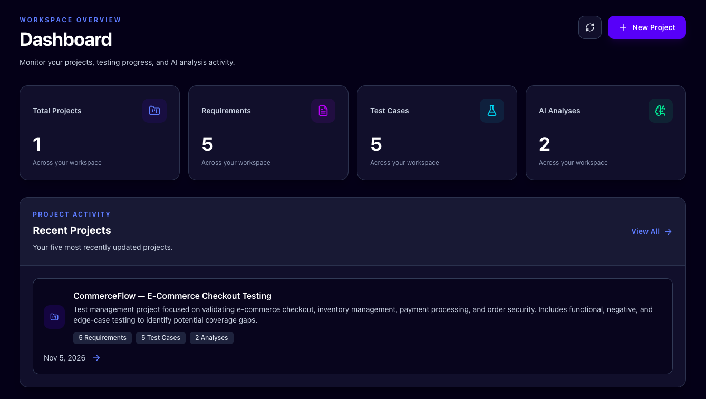
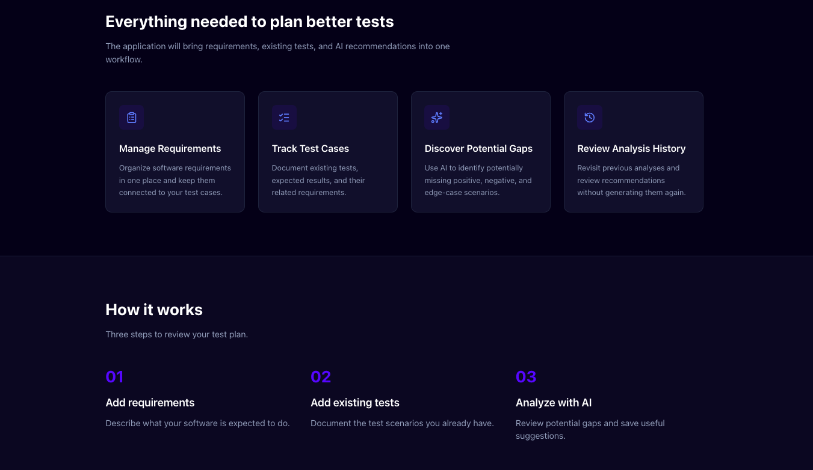
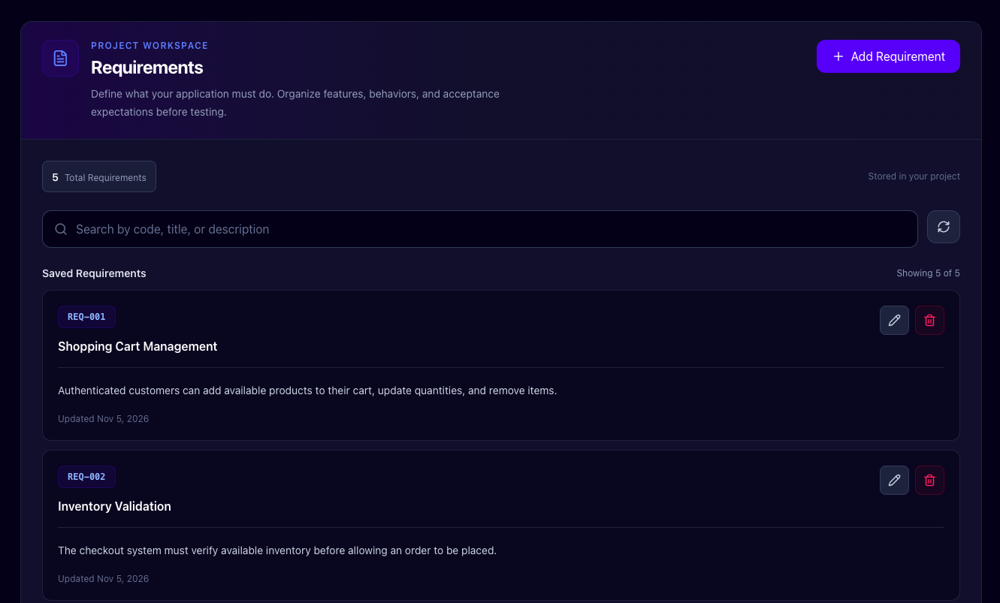
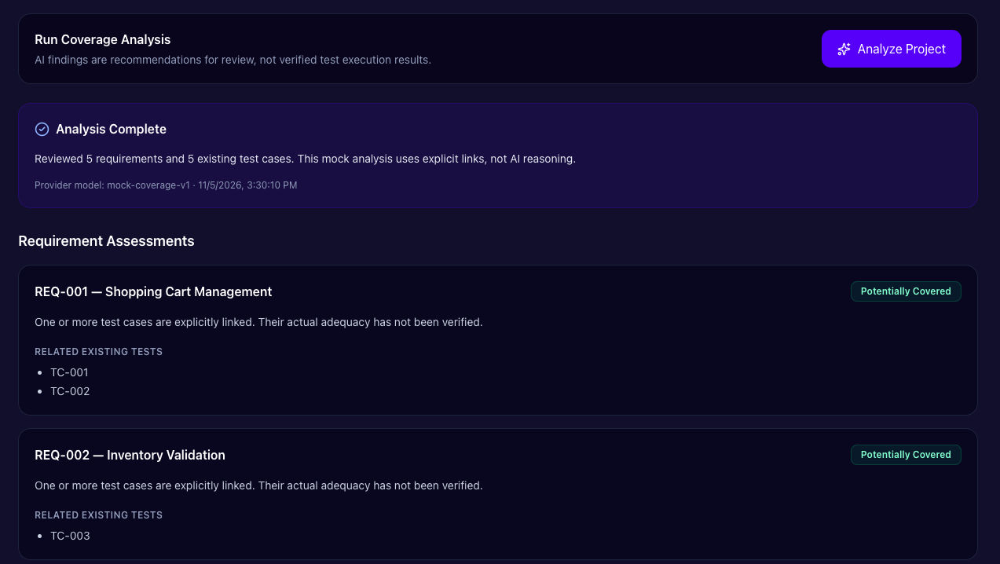
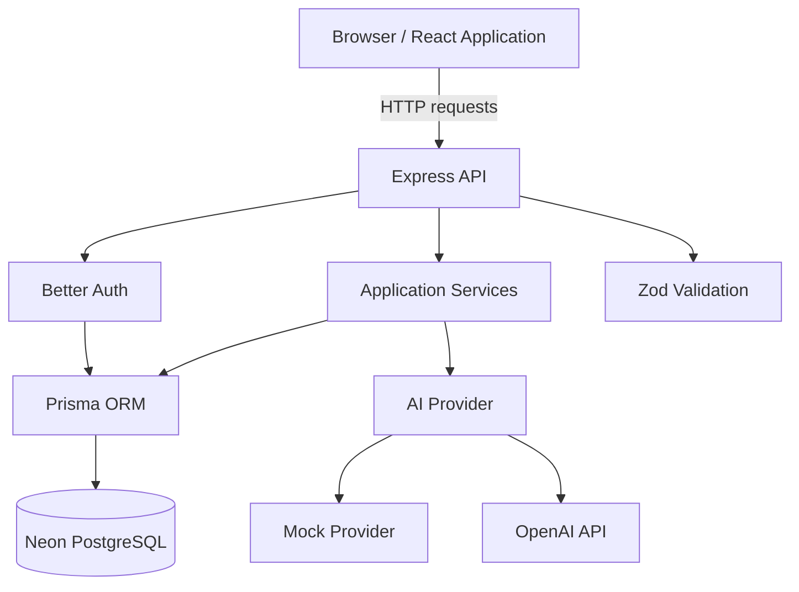
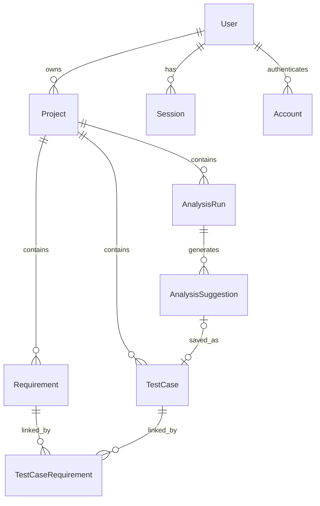

# AI Test Coverage Analyzer

**A full-stack application for managing software requirements, organizing test cases, and identifying potential testing gaps through AI-assisted analysis.**

Built with React, TypeScript, Express, PostgreSQL, Prisma, Better Auth, and the OpenAI API.

**Repository:** https://github.com/divineconnect135/ai-test-coverage-analyzer

**Live Demo:** https://ai-test-coverage-analyzer.onrender.com

> This project assesses potential requirement coverage gaps. It does not execute tests or measure actual code coverage.

---

## Screenshots

### Dashboard



### Features and Workflow



### Requirements & Test Cases



### AI Test Analysis



## Overview

AI Test Coverage Analyzer helps developers and QA engineers organize requirements and test cases in a structured workspace.

Users can create projects, document requirements, link existing tests, and request AI-assisted recommendations for potentially missing scenarios.

Analysis results are stored, allowing users to revisit previous assessments without making another AI request.

## The Problem

Testing information is often spread across documents, spreadsheets, and issue trackers.

This makes it difficult to answer questions such as:

- Which requirements have related test cases?
- Which requirements may need additional testing?
- What negative, edge-case, or security scenarios could be missing?
- What did a previous analysis conclude?
- How can a recommendation be converted into a reusable test case?

This application brings those workflows into one project-based system.

## Features

### Authentication and User Accounts

- Email and password registration and login
- Session-based authentication with Better Auth
- Protected application routes
- User-specific project data
- Logout and authenticated landing-page redirects

### Project Management

- Create, view, update, and delete projects
- Project dashboard and summary statistics
- Search saved projects
- View requirements, test cases, and analyses together

### Requirements Management

- Create and edit requirements
- Assign unique requirement codes within a project
- Store titles and descriptions
- Delete requirements
- Associate requirements with test cases

### Test Case Management

- Create, edit, and delete test cases
- Record execution steps and expected results
- Classify test cases by type
- Track test-case status
- Link test cases to multiple requirements

### AI-Assisted Analysis

- Compare project requirements with documented test cases
- Generate requirement-level coverage assessments
- Identify potential coverage gaps
- Suggest additional testing scenarios
- Display explanations, priorities, steps, and expected results
- Save suggestions as real test cases

### Analysis History

- Save previous analysis runs
- View completed, pending, and failed runs
- Reopen saved assessments and suggestions
- Review original input snapshots
- View historical results without rerunning the AI provider

### Responsive Interface

- Dark-themed dashboard and workspace
- Desktop sidebar and mobile navigation
- Responsive project cards
- Form validation and error messages
- Keyboard focus indicators
- Custom 404 page

---

## Technology Stack

| Layer           | Technology                         |
| --------------- | ---------------------------------- |
| Frontend        | React 19, TypeScript, Vite         |
| Styling         | Tailwind CSS 4                     |
| Routing         | React Router 7                     |
| Backend         | Node.js, Express 5                 |
| Validation      | Zod                                |
| Authentication  | Better Auth                        |
| ORM             | Prisma 7                           |
| Database        | PostgreSQL on Neon                 |
| AI Integration  | OpenAI API and local mock provider |
| Backend Tests   | Vitest, Supertest                  |
| Frontend Tests  | Vitest, React Testing Library      |
| Browser Tests   | Playwright                         |
| Hosting         | Render                             |
| Version Control | Git and GitHub                     |

## Architecture

The project uses a monorepo with separate frontend and backend npm workspaces.



In local development, Vite runs the frontend and proxies `/api` requests to Express.

In production, Express serves both the compiled frontend and the API through one HTTPS origin.

## Project Structure

```text
ai-test-coverage-analyzer/
├── apps/
│   ├── api/
│   │   ├── prisma/
│   │   ├── src/
│   │   │   ├── ai/
│   │   │   ├── config/
│   │   │   ├── controllers/
│   │   │   ├── middleware/
│   │   │   ├── routes/
│   │   │   ├── schemas/
│   │   │   ├── security/
│   │   │   ├── services/
│   │   │   ├── app.ts
│   │   │   └── server.ts
│   │   └── tests/
│   └── web/
│       ├── e2e/
│       ├── public/
│       ├── src/
│       │   ├── components/
│       │   ├── lib/
│       │   ├── pages/
│       │   ├── App.tsx
│       │   └── main.tsx
│       └── tests/
├── .github/
│   └── workflows/
├── scripts/
├── SECURITY.md
├── package.json
└── README.md
```

## Database Design

The database stores authenticated users, projects, requirements, test cases, analysis runs, and generated suggestions.



### Key Relationships

- A user can own multiple projects.
- Each project contains requirements, test cases, and analysis runs.
- Requirements and test cases have a many-to-many relationship.
- Each analysis run stores the input snapshot used at execution time.
- An analysis run can generate multiple suggestions.
- A suggestion can be saved as a test case, preserving its source reference.

Prisma migrations are maintained under `apps/api/prisma/migrations`.

---

## How AI Analysis Works

1. A user selects a project with at least one requirement.
2. The backend verifies authentication and project ownership.
3. Express retrieves the project's requirements and existing test cases.
4. The system creates an input snapshot.
5. The configured AI provider receives the analysis input.
6. The backend validates the returned structured result.
7. Assessments, suggestions, and execution metadata are persisted.
8. The frontend displays the results.
9. The user may save individual suggestions as test cases.

### Analysis Modes

**Mock mode:** Uses explicit requirement-to-test links to produce deterministic assessments. It is suitable for development and automated testing.

**OpenAI mode:** Uses a configured OpenAI model to produce AI-assisted assessments and suggestions from the supplied descriptions.

Mock mode does not perform semantic AI reasoning.

### Structured Output

The analysis response includes:

```json
{
  "summary": "Possible testing gaps were identified.",
  "requirementAssessments": [
    {
      "requirementId": "requirement-1",
      "assessment": "POTENTIAL_GAP",
      "relatedExistingTestIds": [],
      "explanation": "No related test case was identified."
    }
  ],
  "suggestions": [
    {
      "title": "Reject invalid login credentials",
      "description": "Verify authentication rejects an incorrect password.",
      "type": "NEGATIVE",
      "priority": "HIGH",
      "relatedRequirementIds": ["requirement-1"],
      "reason": "Negative login behavior should be tested.",
      "steps": ["Open the login page", "Enter an incorrect password", "Submit the form"],
      "expectedResult": "Authentication is rejected."
    }
  ],
  "limitations": [
    {
      "description": "No actual tests were executed."
    }
  ]
}
```

This is an illustrative response, not a recorded result from a live OpenAI request.

The backend validates field types, allowed assessment values, referenced requirement IDs, referenced test IDs, response sizes, and suggestion limits before persisting results.

---

## REST API

The main application endpoints require an authenticated session.

### Projects

| Method | Endpoint                   | Description         |
| ------ | -------------------------- | ------------------- |
| GET    | `/api/projects`            | List owned projects |
| POST   | `/api/projects`            | Create a project    |
| GET    | `/api/projects/:projectId` | Get project details |
| PATCH  | `/api/projects/:projectId` | Update a project    |
| DELETE | `/api/projects/:projectId` | Delete a project    |

### Requirements

Base path: `/api/projects/:projectId/requirements`

| Method | Endpoint          | Description        |
| ------ | ----------------- | ------------------ |
| GET    | `/`               | List requirements  |
| POST   | `/`               | Create requirement |
| GET    | `/:requirementId` | Get requirement    |
| PATCH  | `/:requirementId` | Update requirement |
| DELETE | `/:requirementId` | Delete requirement |

### Test Cases

Base path: `/api/projects/:projectId/test-cases`

| Method | Endpoint       | Description      |
| ------ | -------------- | ---------------- |
| GET    | `/`            | List test cases  |
| POST   | `/`            | Create test case |
| GET    | `/:testCaseId` | Get test case    |
| PATCH  | `/:testCaseId` | Update test case |
| DELETE | `/:testCaseId` | Delete test case |

### AI Analyses

Base path: `/api/projects/:projectId/analyses`

| Method | Endpoint                                      | Description                  |
| ------ | --------------------------------------------- | ---------------------------- |
| POST   | `/`                                           | Run a new analysis           |
| GET    | `/`                                           | List saved analyses          |
| GET    | `/:analysisId`                                | Retrieve an analysis         |
| POST   | `/:analysisId/suggestions/:suggestionId/save` | Save suggestion as test case |

The history list supports pagination through `?page=1`.

### Authentication

Better Auth exposes its authentication routes under `/api/auth/*`, including email sign-up, email sign-in, and sign-out.

### Health Check

`GET /healthz` returns application health information.

---

## Running Locally

### Prerequisites

- Node.js 22
- npm
- A PostgreSQL database
- A Neon connection string or another compatible PostgreSQL connection
- Git

### 1. Clone the Repository

```bash
git clone https://github.com/divineconnect135/ai-test-coverage-analyzer.git
cd ai-test-coverage-analyzer
```

### 2. Install Dependencies

```bash
npm ci
```

### 3. Configure the Backend Environment

Create `apps/api/.env` with values for your own development database.

```dotenv
NODE_ENV=development
PORT=4000

DATABASE_URL=YOUR_POOLED_POSTGRESQL_URL
DIRECT_URL=YOUR_DIRECT_POSTGRESQL_URL

BETTER_AUTH_SECRET=REPLACE_WITH_A_SECRET_OF_AT_LEAST_32_CHARACTERS
BETTER_AUTH_URL=http://localhost:4000
WEB_ORIGIN=http://localhost:5173

AI_PROVIDER=mock
```

Use the Neon pooled connection string for `DATABASE_URL` and the direct connection string for `DIRECT_URL`.

Do not commit this file.

### 4. Generate Prisma Client

```bash
npm exec --workspace apps/api -- prisma generate
```

### 5. Apply Database Migrations

For a database with an existing committed migration history:

```bash
npm exec --workspace apps/api -- prisma migrate deploy
```

For development schema changes, create and review migrations locally before committing them. Do not generate development migrations against production.

### 6. Start the Application

```bash
npm run dev
```

Default development addresses:

- Frontend: http://localhost:5173
- Express API: http://localhost:4000

### 7. Create an Account

Open the registration page and create a local test account.

You can then create projects, requirements, and test cases, and run mock analysis without an OpenAI API key.

---

## Configuring Real OpenAI Analysis

The application defaults to the mock provider.

To use a real supported OpenAI model, configure these backend environment variables:

```dotenv
AI_PROVIDER=openai
OPENAI_API_KEY=YOUR_PRIVATE_API_KEY
OPENAI_MODEL=YOUR_SUPPORTED_MODEL_ID
```

Do not place the OpenAI key in React source code or a frontend environment variable.

The backend also supports configuration for request limits, input-size limits, suggestion count, output tokens, and provider timeouts.

Real OpenAI calls can incur charges. Use fictional test data when evaluating this feature.

---

## Automated Testing

### Backend Tests

```bash
npm test --workspace apps/api
```

### Backend Type Checking

```bash
npm run typecheck --workspace apps/api
npm run typecheck:tests --workspace apps/api
```

### Frontend Component Tests

```bash
npx vitest run --config apps/web/vitest.config.ts
```

### Playwright End-to-End Test

```bash
npx playwright install chromium
npx playwright test --config apps/web/playwright.config.ts
```

The browser workflow uses a dedicated test account configured through `apps/web/.env.e2e.local`.

Example configuration:

```dotenv
E2E_EMAIL=YOUR_REGISTERED_TEST_ACCOUNT_EMAIL
E2E_PASSWORD=YOUR_TEST_ACCOUNT_PASSWORD
E2E_RUN_AI=0
```

The browser test creates a disposable project, checks persistence, and attempts to remove its test data.

Run it only against a development or dedicated test database, never against production.

### Other Checks

```bash
npm run typecheck
npm run lint
npm run build
npm audit --omit=dev
```

---

## Deployment

The application is designed for a same-origin production deployment.

### Hosting

- **Render:** Node.js web service hosting the Express API and built React application
- **Neon:** PostgreSQL database
- **GitHub Actions:** Manually triggered Prisma production migrations

### Production Build Command

```bash
npm ci --include=dev && npm exec --workspace apps/api -- prisma generate && npm run build --workspace apps/api && npm run build --workspace apps/web
```

### Production Start Command

```bash
node scripts/start-production.mjs
```

### Required Production Configuration

Configure production database URLs, Better Auth secret, public HTTPS origin, and the AI provider through Render's protected environment settings.

Production database migrations are applied separately through `.github/workflows/production-migrate.yml`.

Do not run destructive browser tests or development migrations against the production database.

---

## Security Considerations

The application includes:

- Session-based authentication
- Project ownership checks at the API layer
- Zod validation for incoming application data
- Structured validation of AI results
- HTTP security headers
- Origin checks for browser mutations
- General, authentication, and AI request-rate limits
- Request body-size limits
- Server-side AI key configuration
- AI usage restrictions
- Explicit user approval before saving suggested tests

Some request limits use in-memory counters and are not designed as distributed rate limiting across multiple server instances.

For further details and deployment requirements, see [SECURITY.md](SECURITY.md).

## AI Limitations

The application does not:

- Execute test suites
- Inspect full source-code coverage
- Measure line, branch, or function coverage
- Guarantee the correctness of AI recommendations
- Prove that a software defect exists
- Guarantee complete requirement coverage

AI outputs are suggestions for human review.

The quality of an assessment depends on the completeness and clarity of the requirements and test-case descriptions supplied by the user.

## Challenges and Engineering Decisions

### Preventing Unauthorized Data Access

Project-owned resources are queried using authenticated ownership information instead of trusting client-supplied user identifiers.

### Keeping AI Responses Predictable

AI responses follow a strict structured schema. The backend additionally checks references against the requirements and tests actually supplied for analysis.

### Avoiding Unnecessary AI Costs

The system supports a deterministic mock provider, persisted analysis history, request limits, and explicit user-triggered analysis.

### Managing Production Authentication

A same-origin deployment simplifies browser cookies and API requests. Production origins and authentication configuration must match the deployed HTTPS hostname.

### Making Automated Tests Repeatable

Vitest covers application logic and component behavior, while Playwright verifies an authenticated project workflow against a development database.

## Future Improvements

Potential enhancements after MVP verification include:

- Exporting test cases as JSON
- Exporting analysis results as Markdown
- Comparing historical analyses
- Generating reviewable Playwright test suggestions
- Adding improved reporting and dashboards

AI-generated test code would require human review and would not be executed automatically.

## License

No license has been specified for this repository.

All rights reserved unless a license is added.

---

Built as a full-stack software engineering and AI integration portfolio project.
